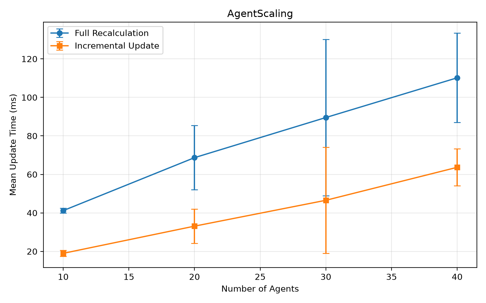
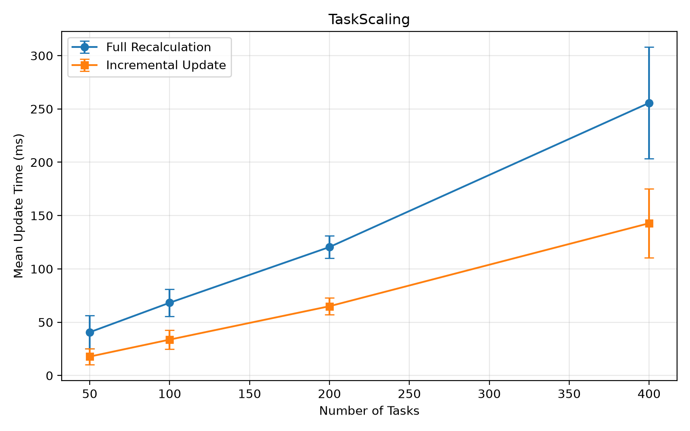
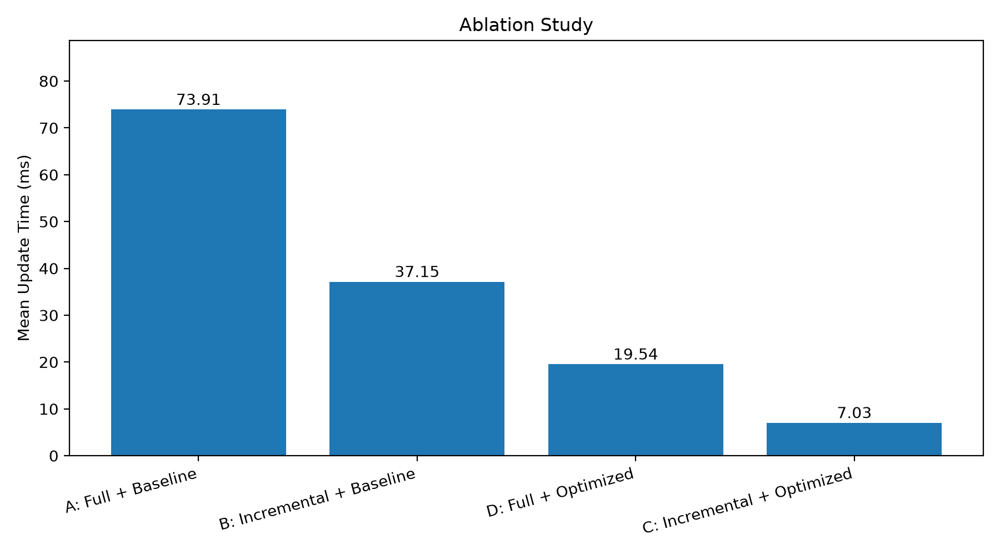
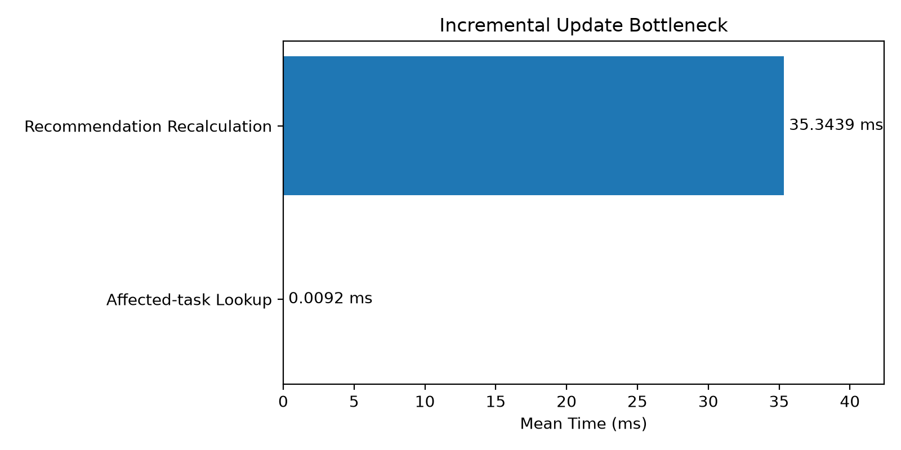

# OntoAgent-Evolve

**Ontology-Driven Dynamic Agent Capability Management and Incremental Team Recommendation**

## 1. Overview

OntoAgent-Evolve is a research prototype for managing the capabilities of AI agents and recommending agent teams in dynamic environments.

When an agent gains or loses a tool, the system updates its RDF-based capability representation and incrementally recomputes recommendations for affected tasks.

The project investigates whether incremental recommendation and optimized capability matching can reduce computation time while preserving minimum-team capability coverage.

## 2. Research Problem

In a dynamic multi-agent system, agent capabilities may change when:

- A new tool is registered.
- An existing tool is removed.
- Multiple tools provide the same capability.
- A task requires a different combination of capabilities.

Recomputing recommendations for all tasks after every change can introduce unnecessary computation.

OntoAgent-Evolve addresses this problem using ontology-based capability representation and selective recommendation updates.

## 3. System Architecture

The system consists of five main components:

1. **Ontology Layer:** Represents agents, capabilities, tool bindings, and their relationships using RDF.
2. **Tool Management Layer:** Registers, validates, and removes agent tools.
3. **Incremental Recommendation Layer:** Identifies affected tasks and updates their recommended agent teams.
4. **Consistency and Persistence Layer:** Validates state consistency, stores registered tool configurations, and supports basic rollback.
5. **API Layer:** Exposes dynamic tool operations through FastAPI.

## 4. Key Features

- Dynamic agent capability updates
- RDF-based tool capability provenance
- SPARQL queries for tool relationships
- Minimum capability-covering agent team recommendation
- Incremental recommendation updates
- Bitmask-optimized capability matching
- Multiple tools supporting the same capability
- JSON-based tool configuration persistence
- Basic in-memory rollback on save failures
- Automated functional and consistency tests
- Performance benchmarking and ablation analysis

## 5. Technology Stack

- Python
- RDFLib
- RDF / OWL / SPARQL concepts
- FastAPI
- PyMuPDF
- Matplotlib

## 6. Getting Started

### Install dependencies

Install the Python packages required by the core prototype:

```bash
python -m pip install rdflib fastapi uvicorn pymupdf matplotlib requests
```

Additional dependencies may be required by optional modules.

### Start the API

From the project root directory:

```bash
python -m uvicorn services.dynamic_api:app --host 127.0.0.1 --port 8001
```

Open the API documentation:

http://127.0.0.1:8001/docs

### Main API Endpoints

| Method | Endpoint | Description |
|---|---|---|
| GET | `/dynamic/status` | View agent capabilities and recommendations |
| POST | `/dynamic/research-agent/pdf-tool` | Register a PDF tool |
| DELETE | `/dynamic/research-agent/pdf-tool` | Remove a PDF tool |
| POST | `/dynamic/execute-pdf` | Execute PDF reading |
| GET | `/dynamic/ontology/tool-bindings` | Query RDF tool bindings |

The API is intended for local research use and does not currently include authentication.

## 7. Experiments

Four recommendation strategies are evaluated:

| Method | Update Strategy | Matching Algorithm |
|---|---|---|
| A | Full recomputation | Baseline |
| B | Incremental update | Baseline |
| C | Incremental update | Bitmask optimized |
| D | Full recomputation | Bitmask optimized |

### Ablation Results

Configuration: 20 agents, 100 tasks, 3 random seeds, and 10 capability changes per seed.

| Method | Mean Update Time |
|---|---:|
| A | 73.91 ms |
| B | 37.15 ms |
| C | 7.03 ms |
| D | 19.54 ms |

The combined method (C) achieved approximately **10.52× speedup** over the baseline full-recomputation method (A).

Compared with optimized full recomputation (D), incremental optimized recommendation (C) achieved approximately **2.78× speedup**.

These results are based on synthetic benchmark configurations and primarily measure recommendation update time rather than complete agent workflow execution latency.

### Experimental Figures









## 8. Testing

Core tests include:

```bash
python test_invalid_tool.py
python test_capability_sources.py
python test_state_transaction.py
python test_tool_provenance.py
python test_sparql_consistency.py
```

With the FastAPI server running:

```bash
python test_system_e2e.py
```

The tests cover tool validation, capability provenance, recommendation consistency, rollback behavior, and API integration.

## 9. Limitations

- Experimental datasets are primarily synthetic.
- The current API operates as a local single-process prototype.
- JSON persistence does not provide full database transaction guarantees.
- Concurrent updates and crash recovery require further work.
- Tool verification is currently limited to supported test functions and is not equivalent to continuous capability monitoring.
- The recommendation system focuses on capability coverage rather than complete execution cost, quality, or reliability optimization.
- Full autonomous multi-agent workflow execution is not yet implemented.

## 10. Future Work

Potential extensions include:

- Automatic capability discovery from agent/tool metadata
- More expressive RDF/OWL capability models
- Scalable incremental reasoning and recommendation
- Real-world task and agent benchmarks
- Integration with agent orchestration platforms
- Stronger persistence, transaction isolation, and recovery mechanisms

## 11. Research Objective

The long-term objective is to study how ontology-based capability management can support efficient, reliable, and explainable adaptation in dynamic multi-agent systems.